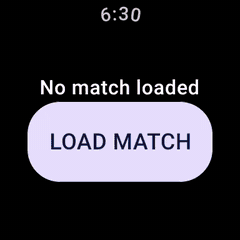

# Match 7x7 companion

A proof-of-concept Wear OS app for recording football match events from the pitch, plus a small mock server that stands in for a real backend.

> **Disclaimer:** this project was **designed by a human and implemented by [Claude Code](https://claude.com/claude-code)** (Anthropic's AI coding agent). The human decided what to build, how the screens and states should work, and reviewed the results on an emulator. Claude Code wrote the code. It has not had an independent code review or a security audit, and it has no automated tests. Treat it as a proof of concept, not as production code.

## Demo



A 75-second run on a Wear OS emulator with the mock server: load a match, kick off, record a goal with an assist, an own goal and a goal without an assist, open the Log and an event's edit screen, end the match, sync (the watch and server numbers match), and close the match.

## What it is

Casual football matches are often logged by one person who has to step off the pitch and use a phone every time someone scores. This app lets that one person (the single writer) log a goal on a watch in a few taps instead:

**Goal → team → scorer → assist → Confirm**

The watch is an **offline recorder**. It loads a match and its roster from a server before kick-off, records events locally while the match is played (nothing is sent during the match), and uploads the whole result once after the final whistle, when the wearer is back within reach of a phone or Wi-Fi.

What the app does:

- **Match life cycle:** no match → load a match from the server's list (with a details screen to check it is the right one) → kick-off → running (match clock in mm:ss, live score) → end → sync → close → no match.
- **Goal flow:** the Goal tap stamps the time immediately and stores a *partial* event, so a goal is never lost even if the flow is abandoned, times out (30 s) or the app is killed. Team, scorer and assist can be filled in afterwards. Own goals are supported (no assist step; the goal is credited to the other team).
- **Confirm step:** Confirm commits the goal. If the confirm timer runs out, only the partial event (the time) is kept. Swiping back goes to the previous step with your picks kept.
- **Fix mistakes live:** the Log lists every event. Tap one to move it in time (±1 min, ±10 s), change its players, or delete it.
- **Local persistence:** everything is stored in a Room (SQLite) database and survives app restarts.
- **Safe sync:** the watch uploads the full result with a single `PUT`, and the server replaces its copy, so retries are harmless. The match counts as synced only if the server's answer lists every event the watch sent. Afterwards the watch shows the server's numbers next to its own so the wearer can compare them. Editing after a sync makes the match unsynced again.

### Limitations

- **Emulator only.** It was developed and tested on a Wear OS 3 (API 30) small round emulator, never on a real watch. Other screen sizes are untested.
- **One match, one writer.** The watch holds a single match at a time. There is no merging of several writers, and no authentication or tokens.
- **Mock server only.** The server is a single-file, in-memory Go program that resets when restarted. The API it offers was invented for this proof of concept; it is not the API of any real system.
- **Hardcoded server address** (`10.0.2.2:8080`, the emulator's address for the host machine), and plain HTTP that is allowed in debug builds only. A release build cannot reach the server as it is.
- **Manual sync only.** There is no automatic retry (for example with WorkManager) and no background upload.
- **Development shortcuts:** a database schema change wipes the local data (`fallbackToDestructiveMigration`); the Confirm timeout keeps only the time of a goal, not the scorer you had picked; the time clamp when moving an event only prevents moving it into the future.
- **Not covered:** ambient mode and battery behaviour, accessibility, localisation (English only), a phone companion app, and any real roster management.
- **Little testing.** It was exercised by driving the emulator by hand (taps and screenshots). There are no unit or UI tests.

## How to use it

### 1. Start the mock server

```sh
cd mockserver
go run .            # listens on :8080 (use -port to change it)
```

It is seeded with three matches (two scheduled, one finished) and prints a log line for every request. Restarting it resets everything.

### 2. Run the watch app

Open the project in Android Studio, start a Wear OS emulator (a small round one works well) and run the `app` configuration. Or from the command line, with an emulator already running:

```sh
./gradlew installDebug
adb shell am start -n com.example.match_7x7_companiom/.presentation.MainActivity
```

### 3. Record a match

1. Tap **LOAD MATCH**, pick a scheduled match, check the details and tap **Load**. (Finished matches are listed read-only.)
2. Tap **KICK-OFF** when the match starts. The clock starts.
3. When someone scores, tap **GOAL**, then the team, the scorer and the assist (or **None**), then **Confirm**. For an own goal, tap **Own**, then the team of the player who put it in and the player, then **Confirm**.
4. Use **Log** to check or fix events: tap an event to change its time, its players, or delete it.
5. Tap **End match** (twice, to confirm) at the final whistle.
6. Tap **Sync** (needs the server to be reachable). Compare the watch and server numbers, then tap **Close match** (twice) to clear the watch.

Before kick-off, **Unload** returns to "no match" if you loaded the wrong one.

### Server API

| Request | Purpose |
|---|---|
| `GET /matches` | List of match summaries: id, scheduled time, status (`SCHEDULED` / `FINISHED`), teams, player count, and score and goal counts when finished. |
| `GET /matches/{id}` | One match with its teams and players. |
| `PUT /matches/{id}/result` | Body `{kickoffAt, endedAt, events: [...]}`. The server replaces its stored result and answers with the match summary, including the list of event ids it stored. |

Each event has `eventId` (UUID made on the watch), `matchId`, `type` (`GOAL` / `OWN_GOAL`), `teamId`, `scorerId`, `assistId` (any of the three can be null for a partial event), `occurredAt` (UTC) and `status` (`COMPLETE` / `PARTIAL`). All times are ISO-8601 UTC strings. The mock server's `main.go` is the reference for the exact shapes, and `app/src/main/java/.../data/Server.kt` is the watch-side client.

### Code map

| Path | What is there |
|---|---|
| `app/src/main/java/.../presentation/` | Compose screens (`Screens.kt`), navigation (`MainActivity.kt`), state and logic (`MatchViewModel.kt`), data classes (`Model.kt`). |
| `app/src/main/java/.../data/` | Room database (`Db.kt`) and the HTTP client (`Server.kt`). |
| `app/src/debug/` | Debug-only network security config that allows plain HTTP to `10.0.2.2`. |
| `mockserver/` | The mock server (Go, standard library only). |
| `docs/` | The demo recording (`demo.gif`). |
| `CLAUDE.md` | The design brief and decisions, written for the AI agent that implemented the project. |

## Requirements

### To try it out (emulator)

- **Android Studio** recent enough to support the Android Gradle Plugin used here (AGP 9.5.2). It brings its own tooling and can install the SDK parts below.
- **Android SDK platform 37** (the project's `compileSdk` / `targetSdk`) and the command-line tools / `adb`.
- A **Wear OS emulator**: a system image for Wear OS 3 / API 30 or newer (the project's `minSdk` is 30). It was tested on a *Wear OS Small Round* virtual device on API 30.
- **JDK:** the Gradle wrapper (Gradle 9.6.0) is included and is configured to use a JDK 25 toolchain, which it downloads automatically if it is missing.
- **Go 1.22 or newer** for the mock server (developed with Go 1.26).
- The emulator must be able to reach the host machine at `10.0.2.2:8080`, which is the default for the Android emulator.

### To port it to a real watch and a real server

- A **Wear OS 3 (API 30) or newer watch** with Wi-Fi or LTE, or a phone connection that gives it network access. Nothing in the app needs a phone app, but the watch must be able to reach the server when syncing.
- **Change the server address.** Replace `Server.BASE` in `data/Server.kt` with the real server's address, ideally as a build setting rather than a constant. On a physical watch `10.0.2.2` does not work.
- **A server that implements the three endpoints above** (or an adapter in front of the real web app), including the replace-style `PUT`. Decide how the real system identifies matches, teams and players, and how it should treat the watch's partial events and own goals.
- **HTTPS and authentication** for any real use. The debug build allows plain HTTP to the emulator's host address only, and the app has no auth at all.
- **Replace the development shortcuts:** write real database migrations instead of wiping data, add automatic retry for sync, and review ambient mode, battery use and error handling on real hardware.
- **Test on a real watch** with real match conditions: sweat, gloves and running change how usable the touch targets and the number of taps feel, and that has not been tested.

## License

[MIT](LICENSE).
